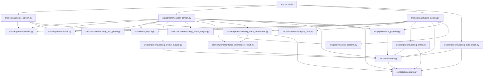

# Attend-X repository navigation guide

This guide was checked against the current repository files. Paths are relative to the repository root. Source line numbers refer to the inspected version and can shift after edits; search for the named function or quoted UI text in VS Code to relocate it.

## 1. Actual repository tree

```text
Attend-X/
├── .gitignore
├── README.md
├── REPOSITORY_GUIDE.md
├── app.py
├── requirements.txt
├── streamlit/                       [local, ignored configuration directory]
│   └── secrets.toml                 [present locally; contents intentionally omitted]
└── src/
    ├── __init__.py
    ├── components/
    │   ├── __init__.py
    │   ├── dialog_add_photo.py
    │   ├── dialog_attendance_result.py
    │   ├── dialog_auto_enroll.py
    │   ├── dialog_create_subject.py
    │   ├── dialog_enroll.py
    │   ├── dialog_share_subject.py
    │   ├── dialog_voice_attendance.py
    │   ├── footer.py
    │   ├── header.py
    │   └── subject_card.py
    ├── database/
    │   ├── __init__.py
    │   ├── config.py
    │   └── db.py
    ├── pipeline/
    │   ├── __init__.py
    │   ├── face_pipeline.py
    │   └── voice_pipeline.py
    ├── screens/
    │   ├── __init__.py
    │   ├── home_screen.py
    │   ├── student_screen.py
    │   └── teacher_screen.py
    └── ui/
        ├── __init__.py
        └── base_layout.py
```

The tracked project has 28 files. The tree above also shows the ignored local `streamlit/secrets.toml` by path only; no secret values have been read or reproduced. `.DS_Store`, `venv/`, Python caches, and `.git/` are excluded as generated or machine-specific content. There are no tracked image/icon files or stylesheets: current logos, mascots, and fonts are loaded from external URLs. There is no `tests/`, deployment manifest, Dockerfile, CI workflow, or database migration/schema file in the inspected repository.

### Missing or noteworthy files

- A checked-in test suite is absent, so there are no repository tests to run for a UI-only change.
- Deployment configuration is absent. The application is started with Streamlit directly (see the README); hosting configuration must be maintained separately.
- No local image assets exist in the tracked tree. Branding images and web fonts require network access to their external URLs.
- The app's local secrets file exists at `streamlit/secrets.toml` and is ignored. `src/database/config.py` also searches `.streamlit/secrets.toml` and `~/.streamlit/secrets.toml`, as well as environment variables and Streamlit secrets.
- Source uses `tomllib` and same-quote f-strings, so the practical Python minimum is 3.12. Do not rely on README's former Python 3.10 statement.
- Empty `__init__.py` files are package markers; they do not contain screens or runtime behavior.
- Directly confirmed unused imports: `src/components/dialog_add_photo.py` imports `enroll_student_to_subject`, `supabase`, and `time` without using them; `src/components/dialog_attendance_result.py` imports `enroll_student_to_subject`, `supabase`, and `time` without using them. This guide does not remove unrelated code.
- No unresolved first-party `src.*` imports were found in the inspected source. Third-party dependencies are declared in `requirements.txt`; importing/runtime behavior still depends on installing them and configuring Supabase.

## 2. File-by-file reference

Risk meanings: **Low** = primarily presentational; **Medium** = presentation and workflow/state are mixed; **High** = authentication, persistence, attendance, or AI behavior can break.

| Exact relative path | File type | Purpose; important functions/classes | Imports / dependencies and who uses it | UI or Logic | Redesign risk |
|---|---|---|---|---|---|
| `app.py` | Python entry point | Streamlit startup, page config, role routing, join-code handling; `main` | Imports home, teacher, student screens and `auto_enroll_dialog`; invoked at module load | Mixed | **High** — chooses authenticated/role screens and processes QR join state. |
| `requirements.txt` | Dependency manifest | Declares Streamlit, Supabase, bcrypt, face/audio ML, image/data, and QR dependencies | Consumed during environment setup/deployment | Configuration | **Medium** — dependency changes can break runtime, ML model imports, or installation. |
| `.gitignore` | Git configuration | Excludes secrets, local environment and generated files | Git uses it; includes both `.streamlit/` and `streamlit/secrets.toml` patterns | Configuration | **Medium** — altering it can expose credentials or add bulky local files to version control. |
| `README.md` | Documentation | Setup, features, and deployment/run instructions | Used by developers; links to this guide | Configuration | **Low** — documentation only, but setup statements must stay accurate. |
| `REPOSITORY_GUIDE.md` | Documentation | This file: tree, references, interaction map, and safe redesign procedure | Used by developers and Claude | Configuration | **Low** — documentation only; regenerate line references after structural edits. |
| `src/__init__.py` | Python package marker | Empty root package initializer | Enables imports under `src`; no consumers call a symbol here | Business logic | **Low** — currently empty; preserve the package marker. |
| `src/components/__init__.py` | Python package marker | Empty components package initializer | Enables `src.components.*` imports | Business logic | **Low** — currently empty; preserve the package marker. |
| `src/components/dialog_add_photo.py` | Streamlit dialog | Camera/upload photo selection; `add_photos_dialog` | Used by `teacher_tab_take_attendance`; Streamlit, Pillow, `st.session_state.attendance_images`. Has unused DB/time imports | Mixed | **High** — its UI mutates the images later consumed for attendance analysis. |
| `src/components/dialog_attendance_result.py` | Streamlit dialog and persistence boundary | Review/discard/save attendance; `show_attendance_result`, `attendance_result_dialog` | Called by face attendance in teacher screen and voice dialog; calls `db.create_attendance`; uses DataFrame and session state. Has unused imports | Mixed | **High** — “Confirm & Save” persists attendance; preserve the supplied `logs` payload and clearing behavior. |
| `src/components/dialog_auto_enroll.py` | Streamlit dialog | Join subject using URL subject code; `auto_enroll_dialog` | Called from `app.main`; directly queries `subjects` and `subject_students`, then calls `db.enroll_student_to_subject`; uses query params/session state | Mixed | **High** — changes enrollments and URL/session flow. |
| `src/components/dialog_create_subject.py` | Streamlit dialog | Subject creation form; `dialog_create_subject` | Called by teacher subject management; calls `db.create_subject` | Mixed | **High** — form values and teacher ID become persistent subject data. |
| `src/components/dialog_enroll.py` | Streamlit dialog | Student enrollment by code; `enroll_dialog` | Called by student dashboard; directly looks up Supabase rows and calls `db.enroll_student_to_subject` | Mixed | **High** — controls enrollment and duplicate-check flow. |
| `src/components/dialog_share_subject.py` | Streamlit dialog | QR/link presentation; `share_subject_dialog` | Called by teacher's subject-share callback; uses Segno and `io.BytesIO`; URL currently points to `snapclass-main.streamlit.app` | Mixed | **Medium** — mainly presentation but link domain, subject code and generated QR must remain correct. |
| `src/components/dialog_voice_attendance.py` | Streamlit dialog | Audio capture, enrolled-student retrieval, voice analysis and review preparation; `voice_attendance_dialog` | Called by teacher attendance tab; queries Supabase directly, calls `voice_pipeline.process_bulk_audio` and `show_attendance_result`; uses pandas/datetime/session state | Mixed | **High** — audio processing, matching, per-student result generation, and the save payload share one function. |
| `src/components/footer.py` | Shared UI component | Home/dashboard footer; `footer_home`, `footer_dashboard` | Called by home screen, student screen, and teacher screen | UI | **Low** — presentational HTML/text only. |
| `src/components/header.py` | Shared UI component | Home/dashboard branding; `header_home`, `header_dashboard` | Called by home screen and student/teacher screens; uses external logo URL | UI | **Low** — presentation-only, but the remote logo URL is a runtime dependency. |
| `src/components/subject_card.py` | Reusable UI component | Subject details, optional stats and callback; `subject_card` | Called by student dashboard and teacher subject manager; Streamlit and caller callback | Mixed | **Medium** — visual HTML is mixed with optional stats and callback invocation; preserve arguments and callback timing. |
| `src/database/__init__.py` | Python package marker | Empty database package initializer | Enables database imports | Database | **Low** — currently empty; preserve the package marker. |
| `src/database/config.py` | Configuration/client setup | Finds Supabase credentials and initializes a client; `_load_secrets_from_file`, `_get_supabase_client`; module-level `supabase` | Imported by `db.py`, teacher screen, and dialogs; uses environment, TOML, Streamlit secrets, Supabase SDK | Configuration | **High** — credential resolution/client initialization gates database functionality. Never put credentials in source or docs. |
| `src/database/db.py` | Database/business logic | Teacher auth, student/subject/enrollment/attendance CRUD and aggregate queries; functions indexed below | Imports module-level `supabase`; used by screens, dialogs, and face model training | Database | **High** — database schema, query fields, password hashes, and attendance persistence are critical. |
| `src/pipeline/__init__.py` | Python package marker | Empty pipeline package initializer | Enables `src.pipeline.*` imports | AI/ML pipeline | **Low** — currently empty; preserve the package marker. |
| `src/pipeline/face_pipeline.py` | AI/ML pipeline | dlib face embeddings, cached model fitting, matching; five functions indexed below | Called by student registration/login and teacher face attendance; fetches students with `db.get_all_students`; uses dlib, sklearn, numpy, Streamlit cache | AI/ML pipeline | **High** — thresholds, embedding shapes, model cache, or returned IDs affect identity and attendance. |
| `src/pipeline/voice_pipeline.py` | AI/ML pipeline | Audio embedding and voice matching; four functions indexed below | Called by student profile registration and `dialog_voice_attendance.py`; uses Resemblyzer, librosa, numpy | AI/ML pipeline | **High** — audio preprocessing, vector similarity, threshold and result shape affect recognition. |
| `src/screens/__init__.py` | Python package marker | Empty screens package initializer | Enables `src.screens.*` imports | Business logic | **Low** — currently empty; preserve the package marker. |
| `src/screens/home_screen.py` | Streamlit screen | Student/teacher portal landing page; `home_screen` | Imported/called by `app.main`; calls `header_home`, `footer_home`, and layout functions; image URLs are external | Mixed | **Medium** — portal buttons change `login_type` and trigger reruns; styling can change without altering that transition. |
| `src/screens/student_screen.py` | Streamlit screen | Face login, student registration, dashboard, enrolled subjects and attendance summary; `student_screen`, `student_dashboard`, nested `unenroll_button` | Imported/called by `app.main`; uses header/footer/layout, enroll dialog, subject card, face/voice pipelines and student DB functions | Mixed | **High** — UI is interleaved with login, biometric capture, registration, enrollment, state and attendance calculations. |
| `src/ui/__init__.py` | Python package marker | Empty UI package initializer | Enables `src.ui.*` imports | UI | **Low** — currently empty; preserve the package marker. |
| `src/ui/base_layout.py` | Shared styles | Global/home/dashboard CSS; `style_background_home`, `style_background_dashboard`, `style_base_layout` | Called by all three screens; Streamlit markdown with CSS and remote Google Fonts | UI | **Low** — visual-only CSS, though global selectors affect all screens and Streamlit controls. |
| `src/screens/teacher_screen.py` | Streamlit screen | Teacher login/registration/dashboard, subject management, face and voice attendance, attendance records; nine functions plus nested `share_btn` | Imported/called by `app.main`; integrates components, layout, Supabase, db functions, face pipeline, pandas and datetime | Mixed | **High** — authentication, session state, analysis, attendance calculations, and UI coexist. |
| `streamlit/secrets.toml` | Local secret configuration (untracked/ignored) | Local Supabase configuration; actual contents intentionally not inspected | Loaded by `src/database/config.py` if present; local-only | Configuration | **High** — may contain secrets; do not display, edit, commit, or copy values into documentation. |

No classes are declared in the inspected Python files.

## 3. Function and class index

All inspected Python definitions are listed below, including the two nested callbacks. “Return” describes the explicit return when present; functions with no explicit return produce Python `None`. The “Called by → dependencies” column distinguishes internal callers from the important operations invoked.

### Startup, shared UI, and screens

| Function / exact file / lines | Parameters and return | Responsibility | Called by → dependencies | Preserve during UI redesign? |
|---|---|---|---|---|
| `main` — `app.py:10-35` | No parameters; no explicit return. | Sets Streamlit page config, defaults `login_type`, dispatches by role, handles `join-code`. | Module startup → `teacher_screen`, `student_screen`, `home_screen`, `auto_enroll_dialog`, Streamlit session/query APIs. | **Yes** — role routing, page config, join-code handling and rerun conditions. |
| `home_screen` — `src/screens/home_screen.py:5-29` | No parameters; no explicit return. | Displays landing-page logo/mascots and portal buttons. | `app.main` → header/footer/layout; button callbacks set `st.session_state['login_type']` and rerun. | **Yes** — preserve the exact role values and reruns when changing layout. |
| `header_home` — `src/components/header.py:4-12` | No parameters; no explicit return. | Renders home branding and remote logo. | `home_screen` → `st.markdown`. | Usually; keep logo source and accessible/visible branding. |
| `header_dashboard` — `src/components/header.py:15-23` | No parameters; no explicit return. | Renders dashboard branding and remote logo. | Student and teacher screens → `st.markdown`. | Usually; keep the shared function callable with no arguments. |
| `footer_home` — `src/components/footer.py:4-12` | No parameters; no explicit return. | Renders landing-page footer. | `home_screen` → `st.markdown`. | Usually; presentation-only. |
| `footer_dashboard` — `src/components/footer.py:15-23` | No parameters; no explicit return. | Renders dashboard footer. | Student and teacher screens → `st.markdown`. | Usually; presentation-only. |
| `subject_card` — `src/components/subject_card.py:2-22` | `name`, `code`, `section`: displayed subject fields; optional `stats`: iterable of `(icon,label,value)` triples; optional `footer_callback`: callable. No explicit return. | Renders subject HTML/stats and then invokes callback, if supplied. | Student and teacher subject screens → `st.markdown`, callback supplied by caller. | **Yes** — preserve parameter names/order, stats shape, and callback invocation. |
| `style_background_home` — `src/ui/base_layout.py:5-22` | No parameters; no explicit return. | Injects home background/column CSS. | `home_screen` → `st.markdown(unsafe_allow_html=True)`. | Usually; keep CSS-only. |
| `style_background_dashboard` — `src/ui/base_layout.py:25-37` | No parameters; no explicit return. | Injects dashboard background CSS. | Student and teacher screen entry points → `st.markdown`. | Usually; keep CSS-only. |
| `style_base_layout` — `src/ui/base_layout.py:42-112` | No parameters; no explicit return. | Injects shared fonts, spacing, heading, and button styles. | Home/student/teacher screens → `st.markdown(unsafe_allow_html=True)`. | Usually; global CSS affects every route. |
| `teacher_screen` — `src/screens/teacher_screen.py:33-54` | No parameters; no explicit return. | Applies dashboard styles and routes to logged-in dashboard, login, or registration according to session state. | `app.main` → `teacher_dashboard`, `teacher_screen_login`, `teacher_screen_register`. | **Yes** — preserve `teacher_data` and `teacher_login_type` state checks. |
| `teacher_dashboard` — `src/screens/teacher_screen.py:58-103` | No parameters; reads `teacher_data`; no explicit return. | Displays welcome/logout and three dashboard tabs. | `teacher_screen` → `header_dashboard`, `footer_dashboard`, the three teacher tab renderers; mutates tab and login state. | **Yes** — preserve tab keys/values, logout behavior, and renderer dispatch. |
| `teacher_tab_take_attendance` — `src/screens/teacher_screen.py:107-204` | No parameters; reads teacher ID and session-stored images; no explicit return. | Displays subject selector/photo gallery and runs photo or voice attendance flow. | `teacher_dashboard` → `get_teacher_subjects`, `add_photos_dialog`, face `predict_attendance`, direct Supabase enrollment query, `attendance_result_dialog`, `voice_attendance_dialog`. | **Yes** — preserve selected subject ID, image state, matching/roster join, and log fields. |
| `teacher_tab_manage_subjects` — `src/screens/teacher_screen.py:216-248` | No parameters; reads teacher ID; no explicit return. | Displays create-subject action and subject cards/share callback. | `teacher_dashboard` → `get_teacher_subjects`, `dialog_create_subject`, `subject_card`; nested `share_btn` calls `share_subject_dialog`. | **Yes** — preserve teacher ID, subject values, and callback association. |
| `share_btn` (nested) — `src/screens/teacher_screen.py:235-238` | Captures current `sub`; no parameters or explicit return. | Renders share button and opens subject link dialog on click. | `teacher_tab_manage_subjects` via `subject_card` callback → `share_subject_dialog`. | **Yes** — preserve callback behavior and subject-code key/link. |
| `teacher_tab_attendance_records` — `src/screens/teacher_screen.py:251-297` | No parameters; reads teacher ID; no explicit return. | Loads and groups teacher records for display. | `teacher_dashboard` → `get_attendance_for_teacher`, pandas group/sort, datetime parsing, `st.dataframe`. | **Yes** — preserve grouping keys, attendance counts, timestamp interpretation and displayed columns. |
| `teacher_screen_login` — `src/screens/teacher_screen.py:306-407` | No parameters; no explicit return. | Renders login form and invokes teacher login; registration button switches screen. | `teacher_screen` → `header_dashboard`, `login_teacher`, `footer_dashboard`; writes `teacher_data` / `teacher_login_type`. | **Yes** — preserve password input type, credential call, session transition and errors. |
| `register_teacher` — `src/screens/teacher_screen.py:414-456` | `teacher_username`, `teacher_name`, `teacher_pass`, `teacher_pass_confirm`; returns `(success: bool, message: str)`. | Validates config, empty fields, username uniqueness and matching passwords, then creates teacher. | `teacher_screen_register` → `check_teacher_exists`, `create_teacher`; reads imported `supabase`. | **Yes** — preserve return tuple, validation order and DB calls. |
| `teacher_screen_register` — `src/screens/teacher_screen.py:463-567` | No parameters; no explicit return. | Renders registration form, calls validator, reports result and switches to login. | `teacher_screen` → `header_dashboard`, `register_teacher`, `footer_dashboard`; mutates `teacher_login_type`. | **Yes** — preserve form-to-validator values and success/failure state transitions. |
| `student_dashboard` — `src/screens/student_screen.py:18-94` | No parameters; reads `student_data`; no explicit return. | Displays student header, enrolled subjects and attendance totals. | `student_screen` → `header_dashboard`, `enroll_dialog`, `get_student_subjects`, `get_student_attendance`, `subject_card`, `footer_dashboard`; nested `unenroll_button` calls DB helper. | **Yes** — preserve student ID, stats definition, logout state and enrollment behavior. |
| `unenroll_button` (nested) — `src/screens/student_screen.py:70-80` | Captures current `student_id`, subject ID/name; no parameters or explicit return. | Displays per-subject unenrollment action. | `student_dashboard` through `subject_card` callback → `unenroll_student_to_subject`, toast, rerun. | **Yes** — preserve captured subject ID and persistence call. |
| `student_screen` — `src/screens/student_screen.py:97-195` | No parameters; no explicit return. | Renders face login and student registration with optional voice enrollment. | `app.main` → layout/header/footer, `predict_attendance`, `get_all_students`, `get_face_embeddings`, `get_voice_embedding`, `create_student`, `train_classifier`; writes student session data. | **Yes** — preserve biometric input path, state keys, created profile fields and model refresh. |

### Dialogs and reusable interaction components

| Function / exact file / lines | Parameters and return | Responsibility | Called by → dependencies | Preserve during UI redesign? |
|---|---|---|---|---|
| `add_photos_dialog` — `src/components/dialog_add_photo.py:9-50` | No parameters; no explicit return. | Switches camera/upload tabs, appends images into `attendance_images`. | Teacher attendance tab → Pillow, camera/file uploader, `st.session_state`, rerun. | **Yes** — preserve tab keys and append behavior; teacher initializes the image list. |
| `show_attendance_result` — `src/components/dialog_attendance_result.py:9-30` | `df`: display DataFrame; `logs`: rows for persistence. No explicit return. | Renders preview, discards or confirms and saves logs. | Face/voice attendance review → `create_attendance`, session-state cleanup, rerun. | **Yes** — preserve `logs`, save call, discard semantics and state cleanup. |
| `attendance_result_dialog` — `src/components/dialog_attendance_result.py:35-36` | `df`, `logs`; no explicit return. | Dialog wrapper around shared result UI. | Teacher photo flow → `show_attendance_result`. | **Yes** — maintain argument forwarding. |
| `auto_enroll_dialog` — `src/components/dialog_auto_enroll.py:9-43` | `subject_code`: code from URL; no explicit return. | Looks up subject, checks duplicate enrollment, confirms enrollment and clears query params. | `app.main` → direct `supabase` queries, `enroll_student_to_subject`, session/query APIs. | **Yes** — preserve subject-code lookup, duplicate check, student ID and URL cleanup. |
| `dialog_create_subject` — `src/components/dialog_create_subject.py:7-23` | `teacher_id`: owning teacher; no explicit return. | Captures code/name/section and creates subject. | Teacher subject tab → `create_subject`, toast/rerun. | **Yes** — preserve all three form values and teacher ID. |
| `enroll_dialog` — `src/components/dialog_enroll.py:9-29` | No parameters; student comes from `student_data`; no explicit return. | Looks up subject by code, rejects duplicate, enrolls student. | Student dashboard → direct Supabase reads and `enroll_student_to_subject`. | **Yes** — preserve duplicate-check and subject/student IDs. |
| `share_subject_dialog` — `src/components/dialog_share_subject.py:8-30` | `subject_name`, `subject_code`; no explicit return. | Builds join URL, QR code, and copyable code. | Teacher `share_btn` → Segno, `io.BytesIO`, Streamlit display. | **Yes** — preserve URL construction and exact code used by auto-enrollment. |
| `voice_attendance_dialog` — `src/components/dialog_voice_attendance.py:14-113` | `selected_subject_id`; no explicit return. | Captures audio, retrieves roster and voice profiles, analyzes audio, builds review DataFrame/logs, displays result. | Teacher attendance tab → Supabase, `process_bulk_audio`, `show_attendance_result`, pandas/datetime/session state. | **Yes** — preserve subject ID, candidate mapping, result statuses, timestamp, log row keys, and `voice_attendance_results`. |

### Database, configuration, and AI/ML functions

| Function / exact file / lines | Parameters and return | Responsibility | Called by → dependencies | Preserve during UI redesign? |
|---|---|---|---|---|
| `_load_secrets_from_file` — `src/database/config.py:10-19` | `path`: TOML path; returns parsed mapping or `{}`. | Reads TOML settings file. | `_get_supabase_client` → `Path`, `tomllib`. | **Yes** — credential lookup depends on it. |
| `_get_supabase_client` — `src/database/config.py:22-48` | No parameters; returns Supabase `Client` or `None`. | Resolves URL/key from environment, candidate TOML files, then `st.secrets`; initializes client. | Module initialization in `config.py` → `_load_secrets_from_file`, Supabase SDK. | **Yes** — preserve precedence and missing-config behavior. |
| `_has_supabase` — `src/database/db.py:5-6` | No parameters; returns whether module-level client is not `None`. | Database configuration guard. | Teacher existence/create/login helpers → imported `supabase`. | **Yes** — auth DB helpers depend on guard behavior. |
| `check_teacher_exists` — `src/database/db.py:9-21` | `teacher_username`; returns bool. | Queries teachers for username. | `register_teacher` → `_has_supabase`, Supabase `teachers` query. | **Yes** — registration uniqueness check. |
| `hash_password` — `src/database/db.py:24-29` | `password`; returns bcrypt hash string. | Hashes password before storage. | `create_teacher` → bcrypt. | **Yes** — stored credential format. |
| `check_password` — `src/database/db.py:32-37` | `password`, `hashed`; returns bool. | Verifies password hash. | `login_teacher` → bcrypt. | **Yes** — authentication verification. |
| `create_teacher` — `src/database/db.py:40-57` | Username/name/password; returns bool. | Hashes password and inserts teacher row. | `register_teacher` → `_has_supabase`, `hash_password`, Supabase insert. | **Yes** — credentials and schema. |
| `login_teacher` — `src/database/db.py:60-82` | Username/password; returns matching teacher mapping or `None`. | Finds teacher and verifies stored password. | `teacher_screen_login` → `_has_supabase`, `check_password`, Supabase select. | **Yes** — login behavior and returned teacher fields. |
| `get_all_students` — `src/database/db.py:85-95` | No parameters; returns student rows. | Reads all student rows. | Student face login and `face_pipeline.get_trained_model` → Supabase `students` query. | **Yes** — recognition depends on student IDs and embeddings. |
| `create_student` — `src/database/db.py:97-100` | `new_name`, optional `face_embedding`, optional `voice_embedding`; returns inserted data. | Inserts student/profile row. | Student registration → Supabase insert. | **Yes** — profile field names and embedding representation. |
| `create_subject` — `src/database/db.py:102-105` | `subject_code`, `name`, `section`, `teacher_id`; returns inserted data. | Inserts subject row. | `dialog_create_subject` → Supabase `subjects` insert. | **Yes** — DB schema and ownership. |
| `get_teacher_subjects` — `src/database/db.py:107-121` | `teacher_id`; returns subjects augmented with `total_students`, `total_classes`. | Queries subjects and derives counts from embedded relations. | Teacher attendance and subject-management tabs → Supabase relation query. | **Yes** — returned keys drive cards, selector and attendance. |
| `enroll_student_to_subject` — `src/database/db.py:123-126` | `student_id`, `subject_id`; returns inserted data. | Inserts enrollment relation. | Manual and URL enrollment dialogs → Supabase `subject_students` insert. | **Yes** — enrollment IDs and relation schema. |
| `unenroll_student_to_subject` — `src/database/db.py:128-130` | `student_id`, `subject_id`; returns deleted data. | Deletes the enrollment relation. | Student `unenroll_button` → Supabase delete. | **Yes** — both filters are required. |
| `get_student_subjects` — `src/database/db.py:133-135` | `student_id`; returns enrollment rows with subject relation. | Reads student's enrolled subjects. | `student_dashboard` → Supabase relation query. | **Yes** — UI expects nested `subjects`. |
| `get_student_attendance` — `src/database/db.py:138-140` | `student_id`; returns attendance rows with subject relation. | Reads student attendance logs. | `student_dashboard` → Supabase relation query. | **Yes** — summary expects `subject_id` and `is_present`. |
| `create_attendance` — `src/database/db.py:143-145` | `logs`: list of attendance records; returns inserted data. | Persists submitted attendance rows. | `show_attendance_result` → Supabase `attendance_logs` insert. | **Yes** — row shape and save boundary. |
| `get_attendance_for_teacher` — `src/database/db.py:147-149` | `teacher_id`; returns joined attendance rows. | Queries attendance records for teacher-owned subjects. | `teacher_tab_attendance_records` → Supabase relation query. | **Yes** — record shape supports teacher summary. |
| `load_dlib_models` — `src/pipeline/face_pipeline.py:13-25` | No parameters; returns detector, shape predictor, face recognizer. | Loads cached dlib models. | `get_face_embeddings` → dlib and `face_recognition_models`. | **Yes** — runtime model initialization. |
| `get_face_embeddings` — `src/pipeline/face_pipeline.py:27-38` | `image_np`; returns list of NumPy face vectors. | Detects faces and computes 128-value descriptors. | Student registration → `load_dlib_models`; each detected face through dlib. | **Yes** — embedding shape and image expectations. |
| `get_trained_model` — `src/pipeline/face_pipeline.py:41-67` | No parameters; cached model mapping (`clf`, `X`, `y`), `None`, or `0` for no usable training vectors. | Reads student embeddings and fits cached SVC. | `train_classifier`, `predict_attendance` → `get_all_students`, sklearn SVC. | **Yes** — model/cache data shape and IDs. |
| `train_classifier` — `src/pipeline/face_pipeline.py:70-73` | No parameters; returns bool of model data. | Clears Streamlit resource cache and triggers retraining. | Student registration → `get_trained_model`. | **Yes** — refresh after a new profile. |
| `predict_attendance` — `src/pipeline/face_pipeline.py:75-106` | `class_image_np`; returns `(detected_student, all_ids, num_faces)`. | Encodes image and matches against trained student vectors using distance threshold `0.6`. | Student face login and teacher photo attendance → `get_face_embeddings`, `get_trained_model`. | **Yes** — tuple shape, IDs, threshold and number of detected faces. |
| `load_voice_encoder` — `src/pipeline/voice_pipeline.py:9-10` | No parameters; returns cached Resemblyzer encoder. | Loads voice model. | `get_voice_embedding`, `process_bulk_audio` → `VoiceEncoder`. | **Yes** — cached pipeline dependency. |
| `get_voice_embedding` — `src/pipeline/voice_pipeline.py:13-23` | `audio_bytes`; returns list embedding or `None` on processing error. | Loads/resamples audio, preprocesses and embeds it; reports processing error in Streamlit. | Student registration → `load_voice_encoder`, librosa and Resemblyzer. | **Yes** — registration profile vector format. |
| `identify_speaker` — `src/pipeline/voice_pipeline.py:26-43` | `new_embedding`, `candidates_dict`, optional cosine threshold `0.65`; returns `(speaker_id_or_None, score)`. | Selects highest dot-product candidate and applies threshold. | `process_bulk_audio` → NumPy dot product. | **Yes** — threshold and tuple semantics. |
| `process_bulk_audio` — `src/pipeline/voice_pipeline.py:47-76` | `audio_bytes`, candidate student-ID-to-embedding mapping, optional threshold `0.65`; returns `{student_id: best_score}` or `{}` on handled processing failure. | Splits audio into speech segments, embeds and matches them. | `voice_attendance_dialog` → `load_voice_encoder`, `identify_speaker`, librosa. | **Yes** — candidate format, match threshold, output keys/scores. |

## 4. Import and call relationship map

### Confirmed route and operation relationships

- `app.py` imports `home_screen`, `teacher_screen`, `student_screen`, and `auto_enroll_dialog`. `main()` selects a screen from `st.session_state['login_type']`, then separately handles the optional `join-code` query parameter.
- `home_screen.py` imports and calls `header_home`, `footer_home`, `style_background_home`, and `style_base_layout`.
- `student_screen.py` imports and calls `header_dashboard`, `footer_dashboard`, shared layout styles, `subject_card`, `enroll_dialog`, face/voice pipelines and student DB functions. The dashboard invokes `get_student_subjects`, `get_student_attendance`, and `unenroll_student_to_subject`. Face registration uses `create_student`; login uses `get_all_students`; new profile creation invokes `train_classifier`.
- `teacher_screen.py` imports and calls shared layout/header/footer/card and the subject/photo/result/voice dialogs. `teacher_tab_take_attendance` calls `get_teacher_subjects`; photo input passes through `predict_attendance`; the selected course roster is fetched with a direct Supabase query; result confirmation is delegated to `show_attendance_result`. Voice mode calls `voice_attendance_dialog`.
- Teacher subject management calls `get_teacher_subjects`, opens `dialog_create_subject`, and supplies `share_btn` to `subject_card`; the callback opens `share_subject_dialog`.
- Teacher login calls `login_teacher`; registration uses `register_teacher`, which calls `check_teacher_exists` and `create_teacher`.
- `dialog_create_subject.py` calls `create_subject`; `dialog_enroll.py` and `dialog_auto_enroll.py` call `enroll_student_to_subject`; student dashboard's nested `unenroll_button` calls `unenroll_student_to_subject`.
- Both face and voice result review reach `dialog_attendance_result.show_attendance_result`; its Confirm & Save button calls `db.create_attendance(logs)`.
- Face pipeline gets model data through `db.get_all_students`; voice pipeline is invoked through the voice attendance dialog. Student registration optionally calls `get_voice_embedding`.
- Supabase configuration is created once as module-level `src.database.config.supabase`. `db.py` imports it; teacher screen and several dialogs also issue direct Supabase queries. This direct-query boundary is important when tracing table access.
- Student logout clears `student_data`, leaving `login_type` as `student`; teacher logout clears `teacher_data`, leaving `login_type` as `teacher`. In each case, the app remains on that role's login/registration screen rather than returning to home. Preserve unless intentionally changing navigation.

### Mermaid dependency diagram



### Coupling and movement cautions

- No circular first-party imports were found in the inspected import graph.
- `teacher_screen.py` and `student_screen.py` are tightly coupled to Streamlit reruns/session state and pass IDs into data operations. Moving UI sections without their state and call-site contracts risks breaking behavior.
- `show_attendance_result` is a shared persistence boundary for two analysis modes; do not duplicate or bypass its `logs` contract.
- `src.database.config.supabase` is initialized at import time and imported directly in addition to `db.py`. Moving configuration or replacing direct queries requires updating every consumer.
- Face model training is cached in `face_pipeline.py`; registration intentionally calls `train_classifier()` to clear/update cached resources. Preserve this coupling if rearranging registration.
- QR join uses the `subject_code` query parameter in `app.py` and enrollment lookups in `dialog_auto_enroll.py`; the share URL generated in `dialog_share_subject.py` must remain compatible.
- Shared styling is global CSS injected from `base_layout.py`; global selector changes can affect every screen even if made while working on only one page.

## 5. UI element to source location

| Screen / feature | Exact file and function | UI element / unique search phrase | Callback or function called | Related database or pipeline |
|---|---|---|---|---|
| Application branding on landing page | `src/components/header.py`, `header_home` (lines 4-12) | Search `ATTEND-X` or `logo_url` | Called by `home_screen` | External logo URL; no local asset. |
| Application branding on dashboards | `src/components/header.py`, `header_dashboard` (lines 15-23) | Search `header_dashboard` | Called by student and teacher screens | External logo URL; no local asset. |
| Home page backgrounds, global fonts/buttons | `src/ui/base_layout.py`, `style_background_home`, `style_base_layout` | Search `.stApp` or `@import url` | Called by `home_screen` | CSS only; global style function also affects dashboard. |
| Student/teacher portal cards | `src/screens/home_screen.py`, `home_screen` (lines 5-29) | Search `I'm Student` or `Student Portal` | Button sets `login_type` and reruns | `app.main` route state. |
| Student face login | `src/screens/student_screen.py`, `student_screen` (lines 97-195) | Search `Login using FaceID` or `Position your face in the center` | Camera submit calls `predict_attendance`; detected ID leads to profile lookup and session write | `face_pipeline.predict_attendance`; `db.get_all_students`. |
| New student account / optional voice enrollment | `src/screens/student_screen.py`, `student_screen` | Search `Register new Profile` or `Create Account` | Create button computes embeddings and creates profile | `get_face_embeddings`, `get_voice_embedding`, `db.create_student`, `train_classifier`. |
| Student dashboard, welcome/logout, subject summary | `src/screens/student_screen.py`, `student_dashboard` (lines 18-94) | Search `Your Enrolled Subjects` | Calls data loaders; logout clears `student_data`; enroll button opens dialog | `get_student_subjects`, `get_student_attendance`. |
| Student subject card appearance | `src/components/subject_card.py`, `subject_card` (lines 2-22) | Search `background:white; border-left` | Optional `footer_callback` after rendering | Used in student and teacher screens; preserve `stats` triples. |
| Student enroll button | `src/screens/student_screen.py`, `student_dashboard`; `src/components/dialog_enroll.py`, `enroll_dialog` | Search `Enroll in Subject` or `Enroll now` | `enroll_dialog` looks up code and handles duplicate/enroll | Supabase `subjects`/`subject_students`; `db.enroll_student_to_subject`. |
| Student unenroll button | `src/screens/student_screen.py`, nested `unenroll_button` (lines 70-80) | Search `Unenroll from this course` | Calls `unenroll_student_to_subject` | `src/database/db.py`. |
| Teacher login form | `src/screens/teacher_screen.py`, `teacher_screen_login` (lines 306-407) | Search `Login using password` | Login button calls `login_teacher`; Register Instead updates `teacher_login_type` | `src/database/db.py`, Supabase configuration. |
| Teacher registration form | `src/screens/teacher_screen.py`, `teacher_screen_register` (lines 463-567) | Search `Register your teacher profile` | Register now calls `register_teacher`; Login Instead changes screen | `register_teacher` -> `check_teacher_exists`, `create_teacher`. |
| Teacher dashboard tabs and logout | `src/screens/teacher_screen.py`, `teacher_dashboard` (lines 58-103) | Search `Take Attendance` or `current_teacher_tab` | Tab buttons mutate selected tab; logout clears teacher data | Session state and tab rendering functions. |
| Create subject | `src/screens/teacher_screen.py`, `teacher_tab_manage_subjects`; `src/components/dialog_create_subject.py`, `dialog_create_subject` | Search `Create New Subject` or `Create Subject Now` | Dialog submit calls `create_subject` | `src/database/db.py`. |
| Teacher subject stats/cards | `src/screens/teacher_screen.py`, `teacher_tab_manage_subjects`; `src/components/subject_card.py` | Search `Manage Subjects` | Loads subjects and renders card/callback | `get_teacher_subjects`; share dialog. |
| Share subject QR/link | `src/components/dialog_share_subject.py`, `share_subject_dialog` (lines 8-30) | Search `Scan to Join` or `join_url` | Called through `share_btn` from teacher subject card | QR URL query parameter must match app's `join-code` handling. |
| Add classroom photos | `src/components/dialog_add_photo.py`, `add_photos_dialog` (lines 9-50) | Search `Capture or upload photos` | Camera/upload appends to `attendance_images` | `teacher_tab_take_attendance` consumes that session list. |
| Face attendance analysis | `src/screens/teacher_screen.py`, `teacher_tab_take_attendance` (lines 107-204) | Search `Run Face Analysis` | Loops over images and calls `predict_attendance`; creates roster result rows | Face pipeline; direct Supabase `subject_students` + students query. |
| Attendance result review | `src/components/dialog_attendance_result.py`, `show_attendance_result` (lines 9-30) | Search `Confirm & Save` | Confirm invokes `create_attendance(logs)`; Discard clears state | `src/database/db.py:create_attendance`. |
| Voice attendance capture and analysis | `src/components/dialog_voice_attendance.py`, `voice_attendance_dialog` (lines 14-113) | Search `Analyze Audio` or `Record classroom audio` | Calls `process_bulk_audio`, then `show_attendance_result` | Voice pipeline; direct Supabase roster/profile query; attendance save dialog. |
| Teacher attendance record table | `src/screens/teacher_screen.py`, `teacher_tab_attendance_records` (lines 251-297) | Search `Attendance Records` or `Attendance Stats` | Groups and formats DB records | `get_attendance_for_teacher`; pandas/datetime. |
| Footer text | `src/components/footer.py`, `footer_home` or `footer_dashboard` | Search `SnapClass • Smart attendance` | Called by home, student, and teacher views | Presentation-only. |

## 6. Safe UI-redesign file map

### A. Likely presentation-focused files

- `src/ui/base_layout.py` — appropriate for CSS, spacing, typography, and colors. Keep the three style function names and calls; CSS is global, so inspect every route after changes.
- `src/components/header.py` — appropriate for logo sizing/alignment and heading styling. Keep `header_home()` and `header_dashboard()` signatures and remote asset behavior unless replacing assets deliberately.
- `src/components/footer.py` — appropriate for footer layout/text. Keep both zero-argument functions.
- `src/components/subject_card.py` — card markup is the main presentation surface. Make small markup/CSS edits only; preserve `name`, `code`, `section`, stats triple format, and `footer_callback` invocation.
- `src/screens/home_screen.py` — appropriate for portal layout/spacing. Keep button text only if relied on by tests/users; most importantly preserve the `login_type` values (`student`/`teacher`) and reruns.
- `src/components/dialog_share_subject.py` — suitable for QR dialog arrangement and styling. Keep the subject code, URL/query format, generated QR payload, and callable signature.

No file is certified “safe” without review: even presentational files may supply values or callbacks to other code.

### B. High-risk files

- `src/database/config.py` — credential lookup and Supabase client initialization.
- `src/database/db.py` — authentication hashes, student/subject/enrollment queries, record calculations, and persistence.
- `src/pipeline/face_pipeline.py` and `src/pipeline/voice_pipeline.py` — biometric processing and match outputs.
- `src/screens/teacher_screen.py` — authentication/session transitions, subject ownership, both attendance flows, and record aggregation.
- `src/screens/student_screen.py` — face login, biometric profile creation, enrollment, session data, and attendance summary.
- `src/components/dialog_attendance_result.py` — shared confirmation/persistence boundary.
- `src/components/dialog_voice_attendance.py` — roster/profile query, analysis, status generation, timestamps, and attendance log creation.
- `src/components/dialog_auto_enroll.py`, `src/components/dialog_enroll.py`, and `src/components/dialog_create_subject.py` — enrollment/subject writes and related duplicate/validation logic.
- `src/components/dialog_add_photo.py` — changes the image list consumed by attendance analysis.
- `app.py` — application role dispatch and join-code auto-enrollment flow.
- `requirements.txt` — package versions and model dependencies can alter startup and ML behavior.
- `streamlit/secrets.toml` — sensitive local config; never include credential values in UI redesigns or commits.

Avoid these files for visual-only requirements unless a visual change genuinely cannot be achieved in a presentation layer. If they must change, isolate the UI block and preserve the contracts described in this guide.

### C. Mixed files requiring special caution

| File | UI-rendering section | Underlying operation | Preserve these contracts | Safer small edit |
|---|---|---|---|---|
| `src/screens/home_screen.py` | `home_screen()` | Portal buttons write role into session state and rerun. | Role values `student` / `teacher`; `st.rerun()`. | Edit columns, spacing, text styles or image presentation, not button bodies. |
| `src/screens/student_screen.py` | `student_screen()` and `student_dashboard()` | Camera recognition, account creation, profile persistence, logout, subject retrieval and enrollment stats. | `student_data`, `student_id`, `login_type`, `is_logged_in`, `user_role`; embeddings; DB helper arguments; `attendance` row keys. | Change local layout markup around existing widgets. Do not replace the complete functions for a styling request. |
| `src/screens/teacher_screen.py` | `teacher_dashboard()`, `teacher_tab_*()`, login/register screen functions | Authentication, subject ownership, face/voice attendance and record aggregation. | `teacher_data`, `teacher_login_type`, `current_teacher_tab`, `selected_subject_id`, `attendance_images`, `logs` field names, exact helper signatures. | Make CSS/layout-only edits in the relevant subsection; do not rewrite callback/DB/pipeline blocks. |
| `src/components/subject_card.py` | `subject_card()` | The callback invoked after card rendering can open dialogs or write DB data. | Function arguments, stats iterable, callback invocation. | Edit HTML/CSS only; keep callback after the card markup and retain provided arguments. |
| `src/components/dialog_add_photo.py` | `add_photos_dialog()` | Camera/upload values are appended to session-managed attendance images. | `photo_tab`, `attendance_images`, camera/upload keys and `Image` objects. | Adjust labels/layout while preserving append and rerun behavior. |
| `src/components/dialog_attendance_result.py` | `show_attendance_result()` | Discard/reset and `create_attendance(logs)` persistence. | `df`, `logs`, `attendance_images`, `voice_attendance_results`, save call. | Change table/button presentation without replacing either action branch. |
| `src/components/dialog_auto_enroll.py` / `dialog_enroll.py` | Dialog form and confirmation widgets | Subject lookup, duplicate detection and enrollment insertion. | Subject code, current student ID, duplicate-check logic, helper arguments, URL cleanup in auto-enroll. | Restyle labels/buttons; leave all query and submit branches intact. |
| `src/components/dialog_create_subject.py` | `dialog_create_subject()` | Validates required fields and writes subject. | `teacher_id`, subject code/name/section, call to `create_subject`. | Adjust presentation only; keep form values and submission. |
| `src/components/dialog_voice_attendance.py` | `voice_attendance_dialog()` | Fetches profiles, processes audio, constructs attendance rows, opens shared save dialog. | `selected_subject_id`, candidate IDs/embeddings, result DataFrame keys, timestamp, log keys, `voice_attendance_results`. | Restyle the explanation and widget placement without changing analysis, data shape or save handoff. |
| `src/components/dialog_share_subject.py` | `share_subject_dialog()` | Builds join URL and QR code. | URL domain, `join-code` query parameter, `subject_code`. | Change layout/visual style while preserving the QR payload and copyable code. |

## 7. Beginner-friendly VS Code navigation

1. **Find the project root.** In VS Code, choose **File → Open Folder…** and open the Attend-X repository directory (the one containing `app.py`, `README.md`, and `requirements.txt`). The current workspace root is `Attend-X/`.
2. **Open a known file.** Press **Cmd+P** (macOS) or **Ctrl+P** (Windows/Linux), type the exact relative path such as `src/screens/teacher_screen.py`, and choose the matching result.
3. **Find a function.** Use **Cmd+Shift+F** / **Ctrl+Shift+F** to search the whole workspace for an exact identifier such as `def teacher_tab_take_attendance` or a unique UI phrase such as `Run Face Analysis`. To search only the opened file, use **Cmd+F** / **Ctrl+F**.
4. **Choose the right similarly named function.** Search for the definition (`def name`) rather than the call, inspect the file path in the search result, and verify the imports/callers. For example, `attendance_result_dialog` is in `src/components/dialog_attendance_result.py`; the reusable `show_attendance_result` in that same file performs the save behavior.
5. **Follow an import/call.** At the top of the caller, inspect `from src... import ...`; use **F12** / **Go to Definition** on the imported name. For example, `teacher_screen.py` imports `voice_attendance_dialog` from `src/components/dialog_voice_attendance.py`, which imports `process_bulk_audio` from `src/pipeline/voice_pipeline.py`.
6. **Identify the exact edit section.** Read the complete named function and its adjacent callers before changing it. Search the UI text and follow the callback, then follow any DB or pipeline call. Use the risk map above; if a function mixes layout and behavior, change only its presentation block.
7. **Inspect a Git diff.** In the Source Control view, inspect every changed file and hunk. Or run `git diff --check` and `git diff --` in the VS Code terminal. Confirm no secret file, unexpected file, session key, callback, DB field, or pipeline output was changed.
8. **Run the app.** From the project root with the project's dependencies and Supabase configuration available, run:

   ```bash
   python -m streamlit run app.py
   ```

   Current source requires Python 3.12 or newer. For a change without configured Supabase access, visual screens may open but DB-backed features cannot be fully verified.
9. **Retest the affected workflow.** For example, after restyling teacher attendance, test subject selection, photo upload/camera, face analysis, voice analysis if changed, review/discard, and save if test credentials/data are available. This repository has no automated test suite.

## 8. Exact-file instruction required in the Claude handoff

Whenever I ask Claude to implement a UI improvement, Claude must provide:

1. The exact relative file path.
2. The exact function or class to find.
3. A unique search phrase or existing code snippet.
4. Whether to replace a small block, add a new component, or replace the complete file.
5. The complete replacement code when a replacement is necessary.
6. Any new asset or file that must be created, including its exact path.
7. The imports or dependencies required.
8. The commands to run the application and verify the change.
9. The expected visual result.
10. A list of existing functionality that must be retested.
11. A warning before any change that could affect authentication, database behavior, AI processing, or attendance logic.

Claude must not give vague directions such as “update the dashboard file” without naming the actual path and function. If Claude has not inspected the relevant file, it must ask to see the file or inspect it through repository access before providing exact replacement code.

## 9. Verification notes

- Tree cross-check used tracked files plus a filesystem listing that excluded virtual environments/caches; the local ignored secrets path was recorded without opening it.
- The Python source was parsed to enumerate definitions and imports. All relevant first-party modules listed in imports exist in the tree; no classes or unresolved first-party import targets were found.
- External image URLs and Google Fonts are referenced directly in source; no corresponding local image/style assets are present.
- No tests, deployment manifests, or schema/migration files are present in the tracked repository.
- Line numbers in this document are navigation aids, not permanent identifiers. Re-search the exact function name or UI phrase after code changes.
- Facts above describe inspected source. Runtime Supabase schema, deployment host settings, image availability and recognition accuracy depend on external services and were not independently verified.
